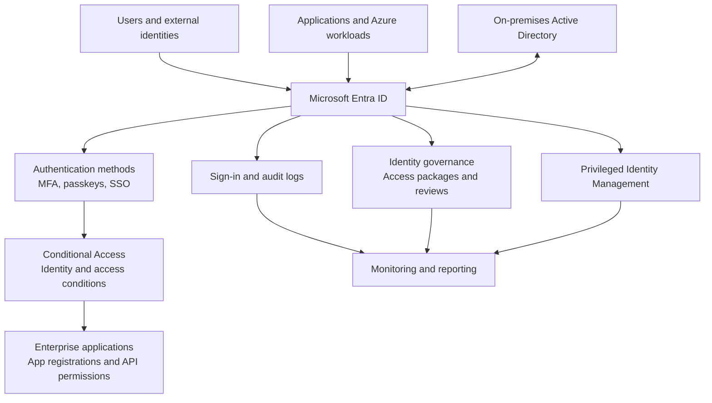
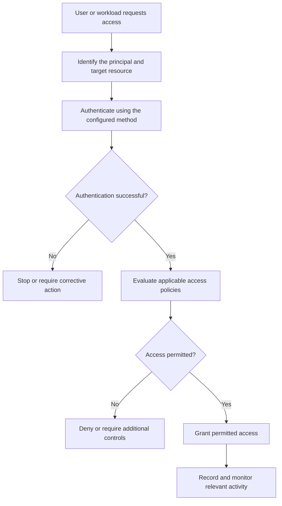
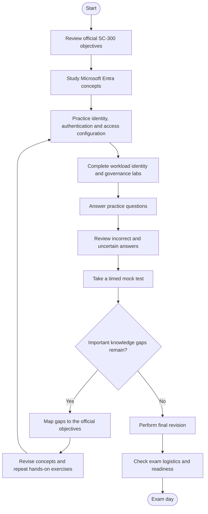
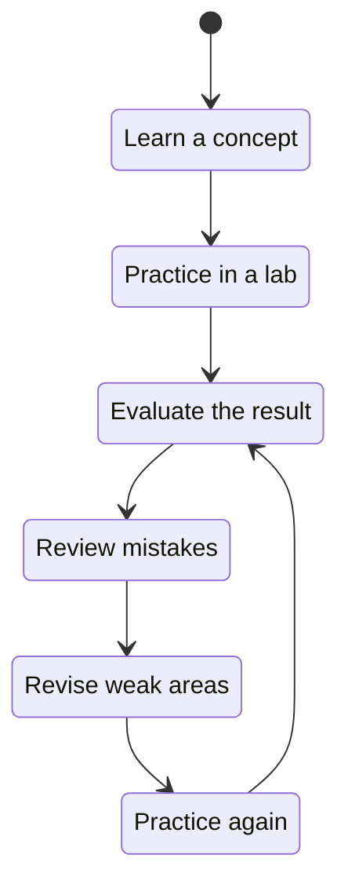
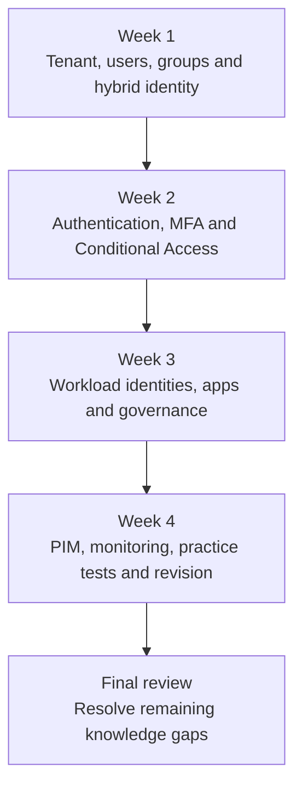

# Microsoft SC-300: Identity and Access Administrator — Study Guide

A practical, community-oriented study guide for preparing for the **Microsoft SC-300 exam**, which leads to the **Microsoft Certified: Identity and Access Administrator Associate** certification.

This repository covers Microsoft Entra ID, identity lifecycle management, authentication, Conditional Access, workload identities, enterprise applications, hybrid identity, privileged access, and identity governance. It combines exam-objective guidance with practical scenarios, PowerShell and KQL examples, diagrams, and a structured revision plan.

**Official exam information:** [Microsoft SC-300 certification page](https://learn.microsoft.com/en-us/credentials/certifications/identity-and-access-administrator/)

**Additional preparation resource:** [CertsGate](https://certsgate.com/) 

---

## Table of Contents

- [Overview](#overview)
- [About the SC-300 Certification](#about-the-sc-300-certification)
- [Who Should Prepare?](#who-should-prepare)
- [Exam Details](#exam-details)
- [Official Exam Objectives](#official-exam-objectives)
- [Exam Domain Weightage](#exam-domain-weightage)
- [Microsoft Entra Identity Architecture](#microsoft-entra-identity-architecture)
- [Authentication and Access Decision Flow](#authentication-and-access-decision-flow)
- [Certification Preparation Flowchart](#certification-preparation-flowchart)
- [Circular Study and Revision Cycle](#circular-study-and-revision-cycle)
- [Step-by-Step Preparation Guide](#step-by-step-preparation-guide)
- [PowerShell and KQL Examples](#powershell-and-kql-examples)
- [Recommended Study Roadmap](#recommended-study-roadmap)
- [Practice Questions](#practice-questions)
- [Hands-On Projects](#hands-on-projects)
- [Common Preparation Mistakes](#common-preparation-mistakes)
- [Career Relevance](#career-relevance)
- [Frequently Asked Questions](#frequently-asked-questions)
- [Official and Additional Learning Resources](#official-and-additional-learning-resources)
- [About CertsGate](#about-certsgate)

---

## Overview

Identity and access management determines who can sign in, which resources they can access, and what actions they are permitted to perform. Poorly designed identity controls can expose applications, data, and administrative privileges even when other security controls are working correctly.

The SC-300 exam focuses on designing, implementing, operating, and troubleshooting identity and access solutions with Microsoft Entra. Preparation requires understanding how identity lifecycle management, authentication, authorization, Conditional Access, workload identities, and governance fit together.

This **SC-300 study guide** provides an organized path through the published exam domains. It also introduces practical scenarios and example commands that help learners connect product documentation with administrative decisions.

### What you will study

- Microsoft Entra tenant and user management
- Groups, roles, administrative units, and licenses
- External identities and cross-tenant access
- Hybrid identity with Microsoft Entra Connect Sync and Cloud Sync
- Multifactor authentication (MFA), passkeys, and self-service password reset
- Conditional Access and Microsoft Entra ID Protection
- Workload identities, managed identities, and service principals
- Enterprise applications, app registrations, and API permissions
- Entitlement management and access reviews
- Privileged Identity Management (PIM)
- Identity monitoring, reporting, PowerShell, and KQL

## About the SC-300 Certification

The **Microsoft Certified: Identity and Access Administrator Associate** certification is intended for professionals who manage identity and access solutions in Microsoft Entra environments.

The role includes managing identity lifecycles, planning authentication and authorization, enabling secure application access, implementing identity governance, and troubleshooting identity-related issues. It also involves applying Zero Trust principles and balancing security with a usable sign-in experience.

Microsoft recommends familiarity with Azure, Microsoft 365 services and workloads, and Active Directory Domain Services (AD DS). PowerShell and Kusto Query Language (KQL) are also useful.

Official reference: [Microsoft Identity and Access Administrator Associate](https://learn.microsoft.com/en-us/credentials/certifications/identity-and-access-administrator/)

## Who Should Prepare?

SC-300 may be relevant to:

- Microsoft Entra administrators
- Identity and access management (IAM) specialists
- Azure and Microsoft 365 administrators
- Security engineers responsible for authentication and authorization
- Administrators implementing Conditional Access and MFA
- Professionals managing enterprise application access
- IT professionals working with hybrid identity
- Security teams responsible for access reviews and privileged roles

If you are new to identity administration, first learn users, groups, permissions, authentication, authorization, and directory services. Then progress to Conditional Access, workload identities, and governance.

## Exam Details

| Item | Information |
|---|---|
| Exam code | SC-300 |
| Certification | Microsoft Certified: Identity and Access Administrator Associate |
| Provider | Microsoft |
| Level | Intermediate |
| Main technology | Microsoft Entra |
| Exam duration | 100 minutes, according to Microsoft's certification page |
| Passing score | 700 or greater |
| Question count | Check current official exam information; do not assume a fixed count |
| Renewal | Annually, through Microsoft's applicable renewal process |
| English-language blueprint update | October 28, 2026 |

The exam is proctored and may include interactive components. Exam availability, languages, policies, pricing, and blueprint details can change. Check the official certification page before booking.

Official links:

- [SC-300 certification and exam information](https://learn.microsoft.com/en-us/credentials/certifications/identity-and-access-administrator/)
- [Official SC-300 study guide](https://learn.microsoft.com/en-us/credentials/certifications/resources/study-guides/sc-300)
- [Microsoft certification renewal](https://learn.microsoft.com/en-us/credentials/certifications/renew-your-microsoft-certification)

## Official Exam Objectives

Microsoft's updated study guide identifies four skill areas. The details below follow the version scheduled to take effect on October 28, 2026. Check the study guide for the version that applies to your exam date and language.

### 1. Implement and Manage User Identities — 20–25%

This domain covers identity administration across a Microsoft Entra tenant, including users, groups, devices, external identities, and hybrid identity.

#### Configure and manage a Microsoft Entra tenant

Study how to:

- Configure built-in and custom Microsoft Entra roles.
- Determine when administrative units are appropriate.
- Configure administrative units and evaluate effective permissions.
- Manage domains in Microsoft Entra ID and Microsoft 365.
- Configure company branding.
- Manage tenant, user, group, and device settings.

#### Create and manage identities

Practice understanding how to:

- Create and manage users and groups.
- Manage custom security attributes.
- Automate bulk operations through the admin center and PowerShell.
- Manage device join and registration.
- Assign, modify, and report on licenses.

#### External and cross-tenant identities

Learn to:

- Configure external collaboration settings.
- Invite and manage external users.
- Configure cross-tenant access.
- Implement cross-tenant synchronization.
- Configure external identity providers, including SAML and WS-Federation where applicable.

#### Hybrid identity

Understand the differences between:

- Microsoft Entra Connect Sync
- Microsoft Entra Cloud Sync
- Password hash synchronization
- Pass-through authentication
- Seamless single sign-on
- Active Directory Federation Services (AD FS) migration
- Microsoft Entra Connect Health

**Practical goal:** Given an organization with cloud and on-premises identities, choose appropriate identity management and synchronization approaches and understand their operational requirements.

### 2. Implement Authentication and Access Management — 25–30% in the published summary

Authentication establishes who a user or workload is. Access management determines whether the authenticated identity can access a resource under the applicable policies.

> **Published-weight note:** Microsoft's updated study guide currently lists 25–30% for this domain in its summary, while the detailed section heading shows 20–25%. Check the live official study guide before allocating study time; this README does not silently resolve that discrepancy.

#### User authentication

Study:

- Authentication planning and authentication methods
- Certificate-based authentication
- Temporary Access Pass
- Microsoft Authenticator
- FIDO2 passkeys
- Multifactor authentication (MFA)
- Self-service password reset (SSPR)
- Windows Hello for Business
- Microsoft Entra password protection
- Revoking sessions and disabling accounts
- Microsoft Entra Kerberos authentication for hybrid identities

#### Conditional Access

Understand how to:

- Plan and assign Conditional Access policies.
- Configure policy controls.
- Test and troubleshoot policies.
- Configure session management and device-enforced restrictions.
- Understand continuous access evaluation.
- Configure authentication context and protected actions.
- Create policies from templates.

Learn to evaluate policy conditions and controls rather than simply memorize a list of settings.

#### Microsoft Entra ID Protection

Study how to manage user risk and sign-in risk, investigate risky users and sign-ins, and remediate risk through the relevant identity protection and Conditional Access capabilities.

Also understand how the published objectives address risky workload identities and multifactor authentication registration campaigns.

#### Global Secure Access

The updated objectives include:

- Deploying Global Secure Access clients
- Managing Microsoft Entra Private Access
- Managing Microsoft Entra Internet Access
- Configuring the Microsoft traffic profile for Microsoft 365

**Practical goal:** Design an access policy that considers user identity, application, device or session context, and risk while minimizing unintended disruption to legitimate users.

### 3. Plan and Implement Workload Identities — 20–25%

Applications and cloud workloads need identities to access resources. Choosing the right identity type helps reduce unnecessary credentials and excessive permissions.

#### Application and Azure workload identities

Learn how to select and configure:

- Managed identities
- Service principals
- User accounts where appropriate
- Managed service accounts

Understand how to assign a managed identity to an Azure resource and use it to access another supported Azure resource.

#### Enterprise applications

Study how to:

- Configure enterprise application settings.
- Assign appropriate administrative roles.
- Integrate SaaS applications.
- Integrate supported on-premises applications through Microsoft Entra Application Proxy.
- Assign users, groups, and app roles.
- Manage user and administrator consent.
- Create and manage application collections.

#### App registrations

Practice understanding:

- When an app registration is needed
- Authentication configuration
- API permissions
- App roles
- The relationship between app registrations and enterprise applications

#### Microsoft Defender for Cloud Apps

The updated objectives include cloud discovery, connected apps, application-enforced restrictions, Conditional Access app control, access and session policies, OAuth app policies, and the cloud app catalog.

**Practical goal:** Given an application access requirement, choose an appropriate identity, configure the necessary permissions, and avoid granting broader access than the workload requires.

### 4. Plan and Automate Identity Governance — 20–25%

Identity governance helps organizations manage access throughout its lifecycle and review whether permissions remain appropriate.

#### Entitlement management

Study:

- Catalogs and access packages
- Entitlement planning
- Access requests
- Terms of use
- External user lifecycle management
- Connected organizations

#### Access reviews

Understand how to plan, configure, and monitor access reviews, and how reviewers or administrators respond to review outcomes.

#### Privileged Identity Management

Learn to manage:

- Microsoft Entra role assignments
- Azure resource roles in PIM
- PIM for Groups
- Request and approval workflows
- PIM settings and assignments
- Audit history and reports
- Emergency access accounts

#### Monitoring and reporting

Study how to review sign-in, audit, and provisioning logs; configure diagnostic settings; send supported logs to destinations such as Log Analytics workspaces, storage accounts, and Azure Event Hubs; and use KQL, workbooks, and Identity Secure Score to monitor identity activity.

**Practical goal:** Design a process that grants access when needed, reviews it regularly, limits standing privilege, and provides useful evidence for audit and troubleshooting.

## Exam Domain Weightage

The updated Microsoft study guide lists the following domain ranges.

| Skill area | Published weight |
|---|---:|
| Implement and manage user identities | 20–25% |
| Implement authentication and access management | 25–30% in the summary; 20–25% in its detailed heading |
| Plan and implement workload identities | 20–25% |
| Plan and automate identity governance | 20–25% |

### Visual comparison of the published ranges

```mermaid id="sc300weights"
xychart-beta
    title "SC-300 Published Domain Weight Ranges"
    x-axis ["User identities", "Authentication/access", "Workload identities", "Identity governance"]
    y-axis "Percentage" 0 --> 35
    bar [20, 25, 20, 20]
    bar [25, 30, 25, 25]
```



The first series shows the lower bound from the summary table, and the second shows the upper bound. The authentication/access lower bound is shown as 25% because that is the summary-table value; Microsoft's detailed heading displays 20–25%. Verify the current official page when preparing for the exam.

A pie chart would imply one fixed percentage for each domain, but Microsoft publishes ranges. This guide therefore uses a range chart instead of inventing a single official distribution.

## Microsoft Entra Identity Architecture

The diagram below illustrates a typical identity and access workflow. It is a conceptual learning diagram, not a mandatory architecture for every tenant.



### How the components fit together

| Component | Purpose |
|---|---|
| Microsoft Entra ID | Manages identities and supports authentication and authorization |
| Authentication methods | Help establish identity using configured methods such as MFA and passkeys |
| Conditional Access | Evaluates configured conditions and applies access controls |
| Enterprise applications | Represent applications and their access configuration in the tenant |
| App registrations | Define application identity and relevant authentication and API permission configuration |
| Identity governance | Helps manage access requests, reviews, and lifecycle requirements |
| Privileged Identity Management | Supports controlled, time-bound or eligible privileged access scenarios |
| Logs and monitoring | Help investigate sign-ins, administrative activity, provisioning, and identity health |

Actual capabilities depend on tenant configuration, licensing, permissions, and product availability.

## Authentication and Access Decision Flow

This simplified flow illustrates how an access request can be evaluated. The actual sequence depends on the application, protocol, identity provider, and configured policies.



Authentication success alone does not mean a user should receive access to every resource. Authorization, Conditional Access, application permissions, and other applicable controls still matter.

## Certification Preparation Flowchart

Use this process to move from the official objectives to exam readiness. If a practice test exposes a knowledge gap, return to the relevant concept and test it again.



## Circular Study and Revision Cycle

Identity administration requires understanding the effects of configuration choices. Repeat this cycle until you can explain the reasoning behind a setting and predict how it affects users or workloads.



For example, after creating a Conditional Access policy in a test environment, examine which users and applications it affects, test expected and unexpected sign-in conditions, and review the results before considering it ready for production.

## Step-by-Step Preparation Guide

### Step 1: Read the applicable exam objectives

Start with Microsoft's official study guide. Confirm the objective version that applies to your exam date and language.

Create a checklist with three statuses:

- **Not started:** The topic is unfamiliar.
- **In progress:** You understand the explanation but need hands-on practice.
- **Ready for review:** You can explain the concept and solve a related scenario.

Pay particular attention to the updated objectives for authentication methods, Global Secure Access, and privileged access when the October 28 version applies.

### Step 2: Build a strong Microsoft Entra foundation

Practice users, groups, roles, administrative units, domains, licensing, and device registration in a suitable lab.

Learn the difference between assigning a directory role and granting an application permission. Understand the scope of administrative units and why least privilege matters.

### Step 3: Study authentication and Conditional Access

Learn the purpose and configuration considerations of MFA, passkeys, Temporary Access Pass, SSPR, and Windows Hello for Business.

For Conditional Access, study assignments, conditions, controls, session management, testing, and troubleshooting. Be able to reason through a scenario instead of simply identifying a setting by name.

### Step 4: Understand hybrid and external identities

Compare Microsoft Entra Connect Sync and Cloud Sync at a conceptual and operational level. Understand the purpose of password hash synchronization, pass-through authentication, and seamless SSO.

Practice external user invitations, cross-tenant access, and cross-tenant synchronization. Pay attention to the distinction between authenticating a user and controlling what that user can access.

### Step 5: Learn application and workload identities

Compare managed identities and service principals, and understand when each may be appropriate.

Practice application registration concepts, authentication configuration, API permissions, app roles, enterprise application settings, and consent. Learn why applications should not receive broader permissions than necessary.

### Step 6: Practice identity governance

Study access packages, catalogs, access requests, access reviews, connected organizations, and terms of use.

Learn how PIM supports privileged access and why eligible access, approval workflows, auditability, and emergency access procedures matter.

### Step 7: Practice monitoring and troubleshooting

Explore sign-in logs, audit logs, provisioning logs, and relevant workbooks. Learn how to send supported diagnostic data to Log Analytics or other configured destinations.

Use KQL to filter and summarize sign-in activity. Interpret the results carefully and distinguish evidence of an issue from proof of a security incident.

### Step 8: Test your knowledge and revise

Use Microsoft's official practice assessment and exam sandbox. For every incorrect or uncertain answer:

1. Identify the objective being tested.
2. Explain why your selected answer was unsuitable.
3. Find the relevant official documentation.
4. Test the concept in a lab if possible.
5. Revisit the question later without relying on memorized wording.

## PowerShell and KQL Examples

The following snippets are illustrative. They require suitable permissions, modules, licensing, data availability, and a properly configured environment. Test commands in a lab before using them in production.

### Example 1: Connect to Microsoft Graph PowerShell

```powershell
Connect-MgGraph -Scopes "User.Read.All"
```

This illustrates connecting to Microsoft Graph with a delegated permission scope. The signed-in user and application must be authorized for the requested operation, and the required consent must be in place.

### Example 2: Retrieve a small set of users

```powershell
Get-MgUser -Top 10 -Property Id,DisplayName,UserPrincipalName |
    Select-Object Id, DisplayName, UserPrincipalName
```

This example demonstrates retrieving a small set of user properties for inspection. It is not a complete bulk-management script.

### Example 3: Inspect sign-in failures in Log Analytics

If the `SigninLogs` table is available in your Log Analytics workspace, this query can help summarize non-successful sign-ins by user and IP address.

```kusto
SigninLogs
| where TimeGenerated > ago(24h)
| where ResultType != "0"
| summarize FailedSignIns = count()
    by UserPrincipalName, IPAddress
| order by FailedSignIns desc
```

**What this query does:**

- Filters records to the last 24 hours.
- Selects records whose result type is not the successful sign-in value.
- Groups events by user and IP address.
- Counts the matching events and sorts the results.

This is an investigation example, not a complete detection rule. Validate the schema and interpret results in context; failed sign-ins can have legitimate explanations.

### Example 4: Explore audit activity

In an environment where the `AuditLogs` table is available:

```kusto
AuditLogs
| where TimeGenerated > ago(7d)
| project TimeGenerated, OperationName, Result, Category
| order by TimeGenerated desc
| take 100
```

This query provides a starting point for inspecting recent audit events. Expand the selected fields when you need additional details about an operation.

### Good habits when using these examples

- Verify available modules, tables, and columns.
- Request only the permissions necessary for the task.
- Use narrow time ranges when exploring unfamiliar data.
- Avoid placing credentials or secrets in scripts.
- Test changes in a non-production environment.
- Confirm results before drawing conclusions or taking action.

## Recommended Study Roadmap

The following four-week plan is an independent study recommendation, not an official Microsoft timetable. Adjust it to your background, available time, and access to a suitable lab.



| Period | Main focus | Suggested output |
|---|---|---|
| Week 1 | Tenant administration, users, groups, roles, external identities, hybrid identity | An identity architecture diagram and administration checklist |
| Week 2 | Authentication methods, MFA, Conditional Access, Identity Protection, Global Secure Access | A set of documented access scenarios |
| Week 3 | Managed identities, enterprise apps, app registrations, entitlement management, access reviews | A workload identity and governance walkthrough |
| Week 4 | PIM, logs, KQL, troubleshooting, practice assessment | A weak-area checklist and revision notes |
| Final review | Revisit difficult objectives and explain configuration decisions | A focused revision sheet aligned with the applicable blueprint |

## Practice Questions

These are original educational examples, not official Microsoft exam questions. They are intended to test understanding of identity and access concepts.

### Question 1: Conditional Access

An organization wants to apply additional access controls when sign-in conditions match a defined policy. Which Microsoft Entra capability is designed for this purpose?

A. Conditional Access  
B. A company branding setting  
C. A user display-name property  
D. An application collection

**Answer: A — Conditional Access.**

Conditional Access evaluates configured assignments and conditions and applies the policy controls. The correct design depends on the scenario and the available features.

### Question 2: Workload identities

An Azure-hosted workload needs to access a supported Azure resource without storing a long-lived secret in application configuration. Which option should you evaluate first?

A. A managed identity  
B. A shared administrator password  
C. A guest user account  
D. A report subscription

**Answer: A — A managed identity.**

Managed identities can provide an identity for supported Azure workloads. The target resource must authorize that identity, and the exact design depends on the service and access requirement.

### Question 3: Privileged access

An administrator should activate elevated permissions only when required and follow the organization's configured access process. Which capability is relevant?

A. Privileged Identity Management  
B. Company branding  
C. A user profile photo  
D. A general distribution list

**Answer: A — Privileged Identity Management.**

PIM supports controlled management of privileged roles and related settings, subject to the applicable configuration and licensing.

### Question 4: Identity governance

An organization wants to periodically check whether users still need access to a group or application. Which capability is most directly relevant?

A. Access reviews  
B. Password hash synchronization  
C. App branding  
D. Device wallpaper configuration

**Answer: A — Access reviews.**

Access reviews help assess whether access remains appropriate and support the configured review and response process.

### Question 5: Application permissions

A registered application needs access to an API. What should an administrator evaluate?

A. The required API permissions, consent, and application access design  
B. The application's display name only  
C. The user's profile photo  
D. Whether the tenant has a custom logo

**Answer: A.**

API permissions, consent, and the application’s intended access are central to a secure integration. Use least privilege and validate the required permission type.

### How to use practice questions effectively

1. Answer before reading the explanation.
2. Explain why the selected answer is appropriate.
3. Identify why the other options do not fit.
4. Map the concept to an official exam objective.
5. Reproduce the relevant configuration in a lab when possible.
6. Revisit incorrect or uncertain answers later.

Use the [official SC-300 study guide](https://learn.microsoft.com/en-us/credentials/certifications/resources/study-guides/sc-300) to access Microsoft's practice assessment and additional preparation resources.

## Hands-On Projects

Use a controlled tenant or authorized lab. Do not experiment with identity or access changes in a production environment without approval.

### Project 1: Tenant identity administration

**Skills:** Users, groups, roles, administrative units.

- Create a small set of test users and groups.
- Explore role assignments and administrative units.
- Compare permissions at different scopes.
- Review how group membership affects access.
- Document the principle of least privilege.

### Project 2: Conditional Access design

**Skills:** Authentication, policy assignments, access controls.

- Define a sample sign-in scenario.
- Identify the relevant users, applications, conditions, and controls.
- Design a policy using the available lab features.
- Test expected and unexpected scenarios using safe testing methods.
- Document the policy's purpose and possible side effects.

Avoid applying an untested policy broadly. Keep appropriate emergency access procedures in mind.

### Project 3: Workload identity

**Skills:** Managed identities, service principals, permissions.

- Identify an Azure workload that supports managed identity.
- Assign an identity in a test environment.
- Grant the minimum required access to a supported target resource.
- Test the expected operation.
- Review access assignments and document how the workload authenticates.

### Project 4: Enterprise application integration

**Skills:** App registrations, enterprise applications, API permissions.

- Create or inspect a test application registration.
- Review its authentication configuration.
- Identify the API permissions needed for the scenario.
- Understand the consent requirements.
- Review the related enterprise application and assignments.
- Document the security implications of each permission.

### Project 5: Identity governance walkthrough

**Skills:** Access packages, access reviews, PIM.

- Define a sample access request.
- Identify who should approve the request.
- Design a review schedule appropriate to the scenario.
- Explore eligible and active privileged access concepts.
- Document what should happen when access is no longer needed.

Use only the features available in your test tenant and subscription.

### Project 6: Identity monitoring

**Skills:** Sign-in logs, audit logs, KQL, reporting.

- Review sample sign-in and audit events.
- Identify useful fields for troubleshooting.
- Write a KQL query to summarize a chosen activity.
- Validate the query's results.
- Document what the events establish and what they do not establish.

## Common Preparation Mistakes

### Memorizing settings without understanding their effects

Know why a policy or configuration exists, which identities it affects, and what behavior it changes.

### Confusing authentication and authorization

Authentication establishes identity. Authorization determines permitted access. Many scenarios involve both, along with Conditional Access and application-specific permissions.

### Ignoring hybrid identity

The exam includes cloud and hybrid identity concepts. Learn the purpose and differences of Microsoft Entra Connect Sync, Cloud Sync, password hash synchronization, pass-through authentication, and SSO.

### Treating Conditional Access as a simple allow-or-block switch

Policy assignments, conditions, controls, session behavior, testing, and troubleshooting all matter. Reason through the scenario before selecting a design.

### Confusing app registrations with enterprise applications

Understand their relationship and the different configuration tasks associated with application identity, authentication, permissions, and tenant access.

### Overlooking workload identities

Applications and Azure workloads also need secure identities. Study managed identities, service principals, app registrations, permissions, and least privilege.

### Treating governance as a one-time task

Access reviews, entitlement management, and privileged access controls support ongoing identity lifecycle management. Learn how they work together.

### Ignoring the exam update date

Microsoft has announced a blueprint change for October 28, 2026. Check the applicable version before studying from older notes or scheduling the exam.

### Repeating mock tests without reviewing mistakes

Practice scores alone do not explain knowledge gaps. Map each error to an objective and revisit the underlying concept.

## Career Relevance

SC-300 preparation can help develop skills used in identity administration, cloud security, access governance, and Microsoft 365 administration.

Related work areas include:

- Identity and access management
- Microsoft Entra administration
- Authentication and access policy design
- Hybrid identity operations
- Enterprise application access
- Workload identity management
- Privileged access management
- Identity governance and access reviews
- Identity monitoring and troubleshooting

Certification preparation provides a structured way to study these areas. Professional effectiveness also depends on practical experience, sound security judgment, clear documentation, and understanding organizational requirements.

## Frequently Asked Questions

### What is the SC-300 exam?

SC-300 is Microsoft's exam associated with the Identity and Access Administrator Associate certification. It covers user identities, authentication and access management, workload identities, and identity governance.

### What is the SC-300 passing score?

Microsoft's study guide states that a score of **700 or greater** is required to pass. Check the official certification page for current exam information.

### How long is the SC-300 exam?

Microsoft's certification page lists a duration of 100 minutes. Confirm current exam details before scheduling.

### Is Microsoft Entra ID the main focus?

Yes. Microsoft Entra identity and access management is central to the certification, including users, applications, authentication, Conditional Access, hybrid identity, and governance.

### Do I need PowerShell and KQL?

Microsoft recommends familiarity with PowerShell and KQL. They are useful for automating administrative tasks and analyzing identity-related logs. Practice the examples in a suitable environment and understand the underlying concepts.

### How long should I prepare?

There is no single preparation period for every candidate. Your existing identity administration experience, available study time, and ability to complete the objectives should determine your schedule. The four-week roadmap in this guide is illustrative, not an official recommendation.

### Are the practice questions in this repository official?

No. They are original educational examples and are not represented as actual, leaked, or official exam questions.

### Which SC-300 objectives should I study?

Start with the official study guide and confirm the version that applies to your exam date and language. Microsoft's English-language objective update is scheduled for October 28, 2026.

### Can CertsGate replace Microsoft Learn?

No. CertsGate is an independent supplementary preparation resource. Microsoft's current study guide and product documentation should remain your primary references.

## Official and Additional Learning Resources

### Official Microsoft resources

1. **[SC-300 certification page](https://learn.microsoft.com/en-us/credentials/certifications/identity-and-access-administrator/)** — exam information, duration, and certification details.
2. **[Official SC-300 study guide](https://learn.microsoft.com/en-us/credentials/certifications/resources/study-guides/sc-300)** — skill areas, domain weights, detailed objectives, and update information.
3. **[Microsoft Identity and Access Administrator course](https://learn.microsoft.com/en-us/training/courses/sc-300t00)** — instructor-led training course and related learning paths.
4. **[Microsoft Entra ID documentation](https://learn.microsoft.com/en-us/entra/identity/)** — identity management, authentication, and access control.
5. **[Microsoft Entra External ID documentation](https://learn.microsoft.com/en-us/entra/external-id/)** — external identity concepts and configuration.
6. **[Microsoft Entra ID Governance documentation](https://learn.microsoft.com/en-us/entra/id-governance/)** — entitlement management, access reviews, and governance.
7. **[Microsoft Entra Privileged Identity Management](https://learn.microsoft.com/en-us/entra/id-governance/privileged-identity-management/)** — privileged access concepts and management.
8. **[Microsoft Graph PowerShell documentation](https://learn.microsoft.com/en-us/powershell/microsoftgraph/overview)** — PowerShell administration using Microsoft Graph.
9. **[Kusto Query Language documentation](https://learn.microsoft.com/en-us/kusto/query/)** — KQL syntax and examples.
10. **[Microsoft Exam Readiness Zone](https://learn.microsoft.com/en-us/shows/exam-readiness-zone/)** — exam preparation videos and sessions.


## About CertsGate

[CertsGate](https://certsgate.com/) is an independent IT certification preparation website. Candidates preparing for SC-300 can visit the [CertsGate SC-300 page](https://certsgate.com/exams/microsoft/sc-300) to explore relevant preparation resources.

Supplementary study guides and practice questions can help reinforce identity concepts and identify topics that need more attention. Use such resources alongside Microsoft's official objectives, product documentation, and practical exercises.

CertsGate is not presented here as a Microsoft certification provider or an officially endorsed Microsoft partner.

**Preparation principle:** Understand the identity lifecycle, authentication, access policies, workload identities, and governance. Practice the relevant administration tasks, review mistakes, and confirm your readiness against the official objectives that apply to your exam date.
